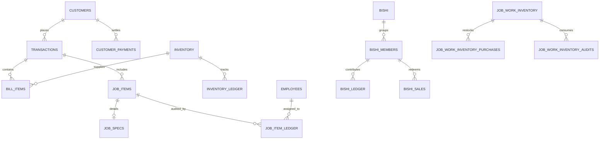

# 🌸 Sonal Boutique — Management & POS System

A modern, full-featured retail management, POS billing, and tailoring operations platform engineered for **Sonal Boutique**.

<p align="left">
  
  
  
  
  
  
  
</p>

---

## 🤝 System Relationship & Ecosystem

```
┌─────────────────────────────────┐           ┌─────────────────────────────────┐
│     Sonal Boutique (Admin)      │           │     Sonal Tailor (Workshop)     │
│  - POS Billing & Invoicing      │           │  - Bill Number Quick Search     │
│  - Record Customer Measurements │           │  - Measurement Inspector        │
│  - Upload Fabric / Sketch Photos│           │  - Fullscreen Design Lightbox   │
│  - Accounting, Ledgers & Bishi  │           │  - Mobile & Tablet Friendly     │
└────────────────┬────────────────┘           └────────────────┬────────────────┘
                 │                                             │
                 │                 Shared                      │
                 └──────────────►  Supabase  ◄─────────────────┘
                                   Database
```

Both applications operate against the **same shared Supabase PostgreSQL database**:
- **Sonal Boutique** acts as the central command hub for the store, handling POS billing, customer ledgers, Bishi chit-funds, and inventory. It pushes tailoring jobs and measurement specifications into the database.
- **Sonal Tailor** (`../SonalTailor`) provides the tailoring team on the workshop floor instant, zero-friction read access on cutting tables and mobile devices to inspect measurements and reference sketches.

---

## 💡 Application Knowledge & Core Modules

### 1. POS Billing & Checkout
- **Hybrid Billing**: Bills support both finished retail goods (from `inventory`) and custom tailoring job orders (from `job_items`) within a single unified checkout.
- **Multiple Payment Modes**: Supports `cash`, `upi`, `credit`, `debit`, and `split` payments.
- **Bishi Redemptions**: Customers enrolled in a Bishi scheme can redeem accumulated savings directly toward bill settlements at checkout.
- **Transaction Lifecycles & Revisions**: Transactions carry statuses (`ACTIVE`, `REVISED`, `CANCELLED`). Editing a finalized bill marks the original as `REVISED` and tracks revision audit references in the `revisions` table.

### 2. Invoicing, Receipts & WhatsApp Sharing
- **Optimized Printing**: Printable invoices and receipts are styled with bold, high-contrast typography ensuring sharp clarity on both digital screens and black-and-white laser/thermal printers.
- **Settlement Receipts**: When customers pay down debt in the customer ledger, staff can immediately generate a dedicated **Settlement Receipt** preview modal with 3 instant actions:
  - 🖨️ **Print**: Compact 1-page printable layout with print-specific media queries.
  - 📄 **Download PDF**: Client-side vector PDF generation using `html2canvas` and `jsPDF`.
  - 💬 **Send WhatsApp**: Direct integration via `/api/whatsapp` to transmit the PDF directly to the customer's phone number.

### 3. Customer Ledger & Opening Balances
- **Credit & Debt Tracking**: Detailed ledger per customer showing `total_billed`, `total_paid`, and current `balance`.
- **Opening Balance Management**: Dedicated, password-free interface for inputting and updating legacy/historical balances for migrated customers.
- **Settlement Recording**: Record partial or complete repayments (`customer_payments`) with payment mode tagging and historical audit logs.

### 4. Bishi (Chit Fund / Rotating Savings)
- **Community Savings Groups**: Organize periodic contribution groups with custom contribution amounts and participant limits.
- **Member Management**: Track individual members, their legacy `opening_balance`, running contribution totals, and redemptions.
- **Contribution Ledger**: Record member contributions per cycle via `bishi_ledger`.
- **Automated Balance Engine (`utils/bishi.ts`)**: Built-in recalculation engine that automatically updates member balances (`opening_balance + total_contributed - total_redeemed`) across transactions and manual ledger updates.

### 5. Tailoring Job Work Pipeline
- **Workload Status Workflow**:
  ```
  ordered ➔ preparation ➔ cutting ➔ stitching ➔ finishing ➔ ironing ➔ complete ➔ delivered
  ```
- **Job Item Ledger**: Logs which employee worked on which tailoring phase with timestamps (`job_item_ledger`).
- **Garment Specifications (`job_specs`)**: Stores structured measurements for blouses, kurtis, pants, sleeves (full, 3/4, elbow, short), necks, and custom notes.
- **Reference Image Uploads**: Supports photo uploads of fabrics, sketches, and customer reference images stored in the Supabase `job-specifications` storage bucket.

### 6. Two-Tier Inventory Management
- **Retail Inventory (`inventory`)**: Ready-made garments, sarees, and accessories with barcode/custom code lookup, selling price, and stock replenishments logged in `inventory_ledger`. Critical edits (stock/name corrections) are protected via password verification.
- **Job Work Inventory (`job_work_inventory`)**: Raw materials and tailoring supplies (fabrics, threads, buttons, laces, zippers, linings) tracked in `metres` or `pieces`, with inward purchase tracking and periodic consumption audits.

### 7. Expense Tracking & Analytics
- **Expenses (OpEx & CapEx)**: Track store operational expenses and capital investments across categories (`salary`, `electricity`, `grocery`, `maintenance`, `transport`, `advertisement`, `miscellaneous`).
- **Store Analytics**: Real-time revenue insights, pending receivables, top inventory movers, and cashflow breakdowns.

---

## 🗄️ Database Architecture & Schema

The application relies on Supabase PostgreSQL with the following core entities:



---

## 📁 Project Structure

```plaintext
SonalBoutique/
├── app/
│   ├── api/              # Route Handlers (billing, bishi, customers, whatsapp, etc.)
│   ├── dashboard/        # Boutique management pages (billing, customers, jobwork, bishi, etc.)
│   └── login/            # Staff authentication
├── components/
│   ├── layout/           # Sidebar and navigation
│   └── ui/               # Reusable UI primitives (Buttons, Cards, Inputs, Modals)
├── docs/                 # Documentation (WhatsApp integration guides)
├── lib/                  # WhatsApp Cloud API service & server secrets
├── types/                # Supabase database types & schema definitions
├── utils/                # Calculation engines (billing, bishi re-calculation, job specs)
└── supabase_migration.sql# Database migrations and RLS policies
```

---

## 🚀 Setup & Getting Started

### 1. Prerequisites
- **Node.js**: v18.18.0 or higher
- **npm** / **yarn** / **pnpm**
- A **Supabase** project instance

### 2. Environment Variables
Create a `.env.local` file in the `SonalBoutique/` root directory:

```env
# Supabase Configuration
NEXT_PUBLIC_SUPABASE_URL=https://your-project.supabase.co
NEXT_PUBLIC_SUPABASE_ANON_KEY=your-supabase-anon-key
SUPABASE_SERVICE_ROLE_KEY=your-supabase-service-role-key

# WhatsApp Cloud API (Optional / For PDF dispatch)
WHATSAPP_PHONE_NUMBER_ID=your-meta-phone-number-id
WHATSAPP_ACCESS_TOKEN=your-meta-system-user-access-token
```

### 3. Database Migrations
1. Apply the primary schema tables from `types/database.types.ts` into your Supabase SQL Editor.
2. Execute [supabase_migration.sql](./supabase_migration.sql) to provision:
   - `job_specs` table and Row Level Security policies.
   - `job-specifications` Supabase Storage bucket for design photos.
   - `opening_balance` column on `bishi_members`.

### 4. Install & Run
```bash
# Install dependencies
npm install

# Start local development server
npm run dev
```

Open [http://localhost:3000](http://localhost:3000) to access the application.
